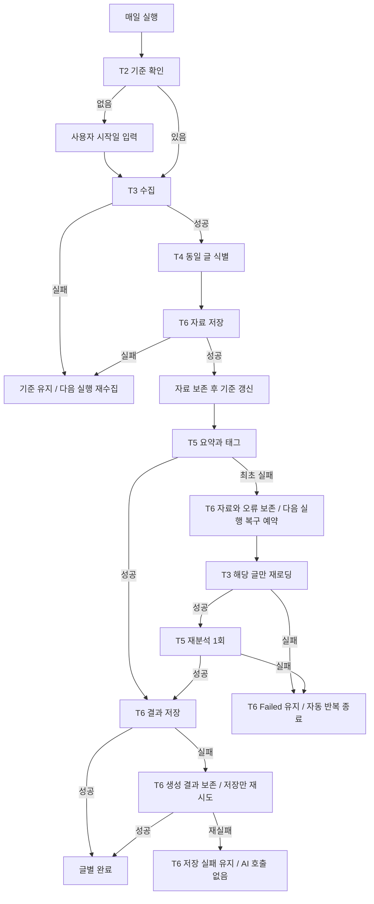

# To-Be Workflow Design

정리일: 2026-11-01. 정책 합의 반영본 v1.0. 설계 문서이며 기능 구현 완료가 아니다.
`✓ Confirmed`: 사용자 합의, `△ Proposed`: 연결·설계 초안, `? Need Check`: 미확인 사항.

## 1. Workflow Overview

- **Workflow Name:** 교육 특강 주제 센싱.
- **Purpose:** 지정 기술 채널의 글을 보존하고 특강 검토용 요약을 제공한다.
- **Trigger:** 매일 1회. 채널 관리(T1)는 사용자 요청 시 별도 수행한다.
- **Final Output:** 수집 기록, 글별 한국어 3문장 요약·태그·참고 근거 또는 실패 기록.
- **Main Actors:** 사용자, System, T5 AI, 별도 최종 특강 결정자.
- **Status:** 정책은 Confirmed, 구체적 Task 연결·정기 System Mode·검증 방식은 Proposed/Need Check.
- **Input References:** [1단계](01-workflow-interview.md) T1~T6·Decision 3, [2단계](02-execution-design.md) Role Allocation·복구 정책, [3단계](03-abcd-design.md) T5·분석 상태·System 경계.

## 2. To-Be Workflow

### Main Flow

사용자 채널 관리 → 매일 실행 → T2 범위 확인 → T3 수집 → T4 동일 글 식별
→ T6 자료 저장 → 자료 보존 후 채널 기준 갱신 → T5 요약·태그 → T6 결과 저장
→ 글별 결과/실패 기록 → 담당자 검토 자료. 최종 특강 선택은 별도 Human 결정이다.

T6:자료와 T6:결과는 같은 T6의 두 호출 지점이다. 기존 Task ID를 분리하지 않았다.
자료 저장은 요약의 선행조건이며, 채널 범위 전체 자료 보존 확인 후 기준 갱신을 제안한다.
건별 분석과 채널별 기준 갱신의 세부 순서는 구현 단계에서 검증한다.

매일 실행은 신규 범위와 허용된 분석 복구를 처리한다. Failed 글은 자동 복구 대상에서 제외한다.
결과 저장 재시도 시각은 미정이며 무제한 자동 반복을 가정하지 않는다.

## 3. Task Map

| ID | Task | Owner / Execution Mode | Input | Core Work / Decision | Output | Next | 상태 |
|---|---|---|---|---|---|---|---|
| T1 | 채널 관리 | Human / 변경 반영 System 제안 | 변경 요청 | 추가·수정·향후 수집 중단, 기존 기록 보존 | 채널 목록 | 정기 T2 | ✓ 정책 / △ 기능 배치 |
| T2 | 범위 확인 | Rule / System 제안 | 채널·저장 기준 | 기준 사용 또는 시작일 질문 | 수집 범위 | T3 / 사용자 입력 후 T3 | ✓ 정책 / △ Mode |
| T3 | 수집·글 재로딩 | Rule / System | 채널·범위 또는 복구 글 ID·URL | 정기 수집과 지정 글 복구 구분 | 본문·처리 결과 | 신규 T4 / 복구 T5 / 실패 기록 | △ 정기 Mode / ✓ 복구 책임 |
| T4 | 동일 글 식별 | Rule / System 제안 | 글·기존 기록 | 동일 기록 식별, 유사 별도 글 보존 | 자료 저장 대상 | T6:자료 | △ 판별 기준 |
| T6:자료 | 자료 보존·기준 갱신 | Rule / System | 수집 자료·처리 결과 | 안전한 저장 후 갱신, 요약 대기 없음 | 저장 글·기준 | T5 / 실패 시 기준 유지 | ✓ 정책 / ? 저장 검증 |
| T5 | 요약·참고 분류 | AI / Agent | 저장 본문 또는 복구 본문 | 3문장 요약·태그·분석 성공 여부 | 결과 또는 분석 실패 | T6:결과 / T6 복구 예약 / Failed | ✓ Mode·권한 |
| T6:결과 | 결과·상태 저장 | Rule / System | 생성 결과·오류·처리 이력 | 기록 또는 결과만 재저장 | 요약·실패 상태 | 글별 완료 / 복구 예약 / 저장 실패 유지 | ✓ 복구 정책 / ? 구현 |

## 4. Role Allocation

### Human
채널 관리, 최초 시작일, 별도 최종 특강 선정. 채널 삭제는 기존 자료 삭제 권한을 뜻하지 않는다.
### Human + AI Assist
별도 필수 Task 없음. 사후 교정은 선택적 지원이다.
### AI + HITL
필수 승인형 Task 없음. 선택적 사후 Knowledge 교정만 Proposed.
### AI / Agent
T5만 확정. 채널·기준 변경, 자료 삭제, 임의 탐색, 최종 선정 권한 없음.
### Rule / System
T3 글 복구·T6 저장 책임은 합의됐다. 정기 T2~T4 Mode는 기존 Proposed를 유지한다.
### No Change
별도 최종 특강 결정 경계 유지. 다른 현행 업무 유지 실익은 정보 부족이다.

## 5. Decision Flow

| Decision | Owner | Criteria | Result | Next Flow |
|---|---|---|---|---|
| 시작점 | System / Human | 기준 유무 | 있음 / 없음 | 수집 / 시작일 입력 후 수집 |
| 기준 갱신 | System | 자료 안전한 저장 | 성공 / 실패 | 갱신 / 유지 후 다음 실행 재수집 |
| 참고 분류 | AI | 세 후보 기준·태그 근거 | 해당 / 미해당 / 미확인 | 모두 결과 기록, 저장 제외 없음 |
| 분석 복구 | System | 최초 실패·복구 이력 | 미시도 / 재실패 | 다음 실행 해당 글 1회 복구 / Failed 유지 |
| 결과 저장 복구 | System | 결과 저장 실패 | 재저장 성공 / 재실패 | 완료 / 저장 실패 유지, AI 호출 없음 |

## 6. HITL Flow

사전 Approval 없음. 시작일 입력은 일반 사용자 입력이지 AI 승인 HITL이 아니다.

| Task | HITL Type | Trigger | Human Role / Decision | Return / Next |
|---|---|---|---|---|
| T5 | 선택적 사후 Knowledge, △ Proposed | 담당자가 오류 발견 | 교육 담당자·전문가 / 요약·태그 교정 | 자료 보존·결과 수정; 종결 실패 수동 재실행은 미정 |

## 7. Exception Flow

| Situation | Detected By | Handling / Owner | Return / End |
|---|---|---|---|
| 기준 없음 | System | 사용자 시작일 질문 | 해당 채널 입력 후 T3; 다른 채널 독립 진행 제안 |
| 채널 수집·자료 저장 실패 | System | 기준 유지·오류 기록 | 다음 실행 범위 재수집 |
| 최초 요약 실패 | AI / System | 자료 유지·1회 복구 예약 | 다음 실행 해당 글 재로딩·재분석 |
| 복구 재실패 | System / AI | Failed 유지 | 자동 반복 종료 |
| 태그 근거 부족 | AI | 미확인 표시 | 정상 기록 |
| 결과 저장 실패 | System | 생성 결과 보존·저장만 재시도 | 성공 완료 / 재실패 저장 실패 유지 |
| 채널 삭제·주소 수정 | Human / System | 기존 기록 보존, 삭제는 향후 수집 중단 | 새 주소 기준·삭제 채널 과거 글 복구 여부 미정 |

## 8. Input / Output Flow

| From | Output | To | Input | 정합성 |
|---|---|---|---|---|
| T1 | 대상 채널 | T2 | 채널·기준 | ✓ 개념 연결 |
| T2 | 범위 | T3 | 채널·범위 | ✓ |
| T3 신규 | 글 | T4 | 글·기존 기록 | ✓ |
| T4 | 저장 대상 | T6:자료 | 글·출처 | △ 중복 기준 미정 |
| T6:자료 | 저장 글 | T5 | 본문·글 ID·출처 | ✓ |
| T5 | 결과·오류 | T6:결과 | 동일 글에 연결된 결과 | ✓ |
| T6 복구 예약 | 글 ID·URL·복구 이력 | T3 복구 | 지정 글 | ✓ 개념 / ? 상태 보존 구현 |
| T3 복구 | 재로딩 본문 | T5 복구 | 본문·복구 이력 | ✓ |
| T6 저장 실패 | 보존된 생성 결과 | T6 재저장 | 동일 결과, AI 호출 없음 | ? Architecture Check Required |

정합성은 사용자 합의 상태와 다르다. 상세 Schema·계약은 다음 단계에서 정의한다.

## 9. Key Design Decisions

- 자료 저장 후 기준 갱신은 사용자 확정. 요약 실패로 전체 채널을 재수집하지 않는다.
- T6 두 호출 지점은 Workflow 배치 제안. 기존 Task 분리나 As-Is 사실 변경이 아니다.
- 분석 복구와 저장 복구를 분리하여 불필요한 AI 호출·무한 반복을 방지한다.
- 삭제/주소 수정 후 기존 기록 보존은 확정. 새 주소의 기준 정책은 후속 설계로 남긴다.

## 10. Back Loop Log

| From | Back To | 발견 문제 | 수정 내용 | 영향 |
|---|---|---|---|---|
| Workflow | Interview | 채널 삭제·갱신·결과 저장 복구 미정 | 사용자 3개 동의로 T1/T6·Decision 3 현행화 | 업무 정책 일치 |
| Workflow | Execution | T6 완료 경계·복구 역할 미정 | 자료 저장 후 갱신·AI 호출 없는 재저장 확정 | 역할 유지, 복구 경로 분리 |
| Workflow | ABCD | AI 성공 결과의 저장 실패 경로 미정 | System 경계·예외·Open Issues 수정 | AI 분석 성공과 저장 성공 구분 |

관련 항목만 갱신했다. 미합의 Mode·API·기능을 자동 승인하지 않았다.

## 11. Open Issues

1. 채널 목록·시작일·실행 시간대, 새 주소 기준·재등록, 삭제 채널의 과거 글 복구 허용 여부.
2. 동일/수정 글 판별, 원문 보존 범위·저장 검증·기준값 경계, 실패 생성 결과의 안전한 보존·재저장 시점과 횟수 상세.
3. 태그 정의·본문/요약 검증, 수동 재실행 범위, 정기 T2~T4 Mode 최종 합의. 실제 시스템 기능이 존재한다고 가정하지 않는다.

## 12. Next Stage Handoff

### Workflow
정기 수집·자료 보존·요약·결과 기록 및 독립 글 복구/저장 복구 경로.
### Task List
T1~T6 유지. T6:자료/결과는 호출 지점이며 T3 신규/복구는 실행 경로다.
### Execution Mode
T5 AI, T6 System, T3 글 복구 역할 확정. 정기 T2~T4는 Proposed.
### Task Input / Output
범위 → 본문 → 저장 글 → 요약/오류 → 결과·복구 이력. 동일 글 연결과 상태 보존이 필요하다.
### Knowledge Requirement
원문·세 후보 기준·태그 정의. 업무 기준은 1단계 T5, Agent 근거는 3단계 참조.
### Inference / Decision
AI는 요약·참고 분류만, System은 범위·저장 검증·처리 이력 기반 분기.
### Agent Tasks
T5만 대상. 저장 글 또는 1회 재로딩된 본문을 공급한다.
### HITL
사전 승인·자동 실패의 강제 응답 대기 없음. 사후 교정은 선택적 제안.
### Human Tasks
채널·시작일·별도 최종 주제 결정.
### Rule/System Tasks
범위·수집·식별·자료/결과 보존·기준 갱신·글 재로딩·복구 제어.
### Decision Branch
기준 있음/없음, 자료 저장 성공/실패, 분석 최초/복구 실패, 결과 재저장 성공/재실패.
### Exceptions
글 단위 복구 1회 후 Failed 유지. 결과 저장 복구는 생성 결과만 사용하고 AI 재호출 없음. 채널 실패는 기준 유지.
### Constraints
전체 자료 보존, 3문장, 미확인 태그, 삭제 후 기록 보존, 요약 대기 없는 기준 갱신. 원문 지시를 실행 명령으로 취급하지 않는 권한 통제를 제안한다. API·DB·연동은 Architecture Check Required.
### Open Issues
11절 사항만 전달. 건별 완료/Failed/저장 실패와 일일 실행 완료를 분리한다. 실행은 각 글의 완료 또는 실패/예약과 채널 결과를 기록하면 종료하는 것으로 제안한다. 다음날은 신규 범위와 허용된 복구만 처리하며 상세 실행 종료 검증은 후속 설계에서 확정한다.